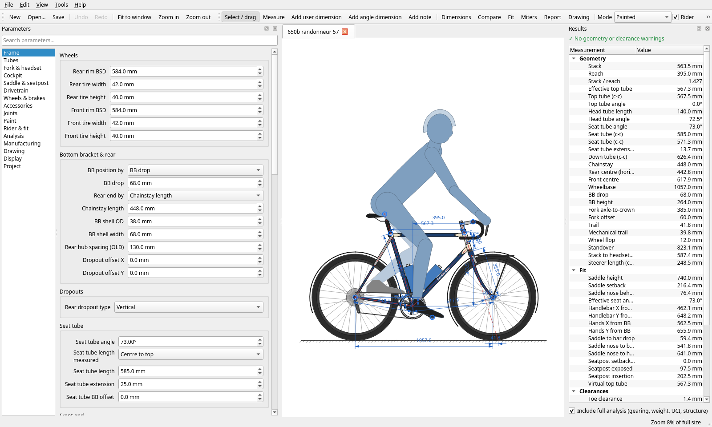

# Bike Box

Open-source, bicycle frame design tool for Linux, MacOS, and Windows.
Geometry, rider fit, spec. drawings, full-scale miter templates, CNC G-code,
analysis and 3-D export.



See the [user guide](docs/USER_GUIDE.md).

## Features

**Geometry**
- Front end defined six ways: head tube length or stack or handlebar height (vertical) × reach,
  front center, effective top tube, wheelbase or handlebar reach (horizontal)
- BB by drop or height; rear end by chainstay length or rear tire gap; seat tube c-t or c-c;
  top tube by angle or seat tube extension; BB offsets for seat and down tubes
- Saddle by height + seat angle (effective seat angle independent of the seat tube) or X/Y
- Curved (bent) tubes, tapered and oval/aero tubes, tapered head tubes, butted walls
- Seat stays on the seat tube or top tube, conventional/wishbone/mono, offset dropouts,
  vertical/horizontal/track/sliding/thru-axle dropouts with axle position in the slot
- Extra tubes (mixte, step-through, cargo, braces) and removable standard tubes
- Rigid or suspension forks (travel, sag), headset stacks, spacers, threadless/quill stems,
  drop/flat/riser/bullhorn/swept bars, levers, hand positions
- Wheels from ISO BSD + tire size, spoke lacing display, disc/rim/cantilever/V brakes,
  drivetrain (chainrings, cassette, derailleurs, single speed, belt, gearbox), bottles,
  fenders, racks, braze-ons, lugs (several styles) and fillets, paint, fades, decals

**Interaction**
- Live drawing with zoom/pan, drag handles (saddle, bars, head tube, rear axle, seat tube, front axle, pedal)
- Double-click a dimension to drive the design from it; drag dimensions to place them
- Parameter editors generated from one schema, searchable; full undo/redo; tabs for many designs
- Dimension catalogue, dimension states, user dimensions (distance, horizontal, vertical, angle)
- Measure tool, on-screen notes, photo underlay with two-point scale calibration
- Compare designs as colored overlays (open designs, files, snapshots); snapshot tool
- Units: mm or inches; display modes: painted, outline, center-line, blueprint

**Fit** — rider anatomy from basic measurements, rider pose (knee/hip/torso/shoulder/elbow angles,
KOPS), Fit Advisor with editable formula-based fitting schemes, center of mass and weight distribution.

**Analysis** — trail, mechanical trail, wheel flop, standover, toe overlap (side view and steered 3-D),
tire/chainring/heel/crown clearances, lean angle, gearing table, chain and belt length, UCI rule
checks, frame weight estimate, a 3-D beam finite-element stiffness/stress estimate, fixture/jig numbers.

**Output** — dimensioned drawing sheets (paper sizes, auto/standard scales, title block with logo,
geometry/tube/custom CSV tables) to PDF, SVG, PNG and printer; DXF (R12); full-scale wrap-around
miter templates (PDF tiled with calibration square, SVG, DXF) for round, oval and tapered tubes;
rotary-axis G-code; cut lists; spec CSV for thousands of designs; multi-model comparison PDF;
bulk export; FreeCAD macro and STL for 3-D; animated GIF morphs between designs.

**Libraries** — design templates (road, endurance, gravel, cyclocross, touring, randonneur, track,
XC/trail hardtails, city step-through, mixte, kids, time trial, fat bike), user templates,
tubing library and standard parts libraries (forks, stems, bars, wheels/tires, BB shells, ...).

## Files

Designs are JSON (`.bikebox`): parameter values by key plus structured extras (notes, user dimensions,
snapshots, extra tubes, title block, tables). Unknown keys survive round trips. BikeCAD `.bcad` files can be
opened, and a design can be saved as `.bcad` (core geometry) via Save As.

## Installers

Pre-built apps for Windows, macOS and Linux are attached to tagged releases.

To build locally with [PyInstaller](https://pyinstaller.org):

```bash
pip install . pyinstaller pillow
python packaging/pyinstaller/make_icons.py          # optional app icons
pyinstaller --noconfirm packaging/pyinstaller/bikebox.spec
```

The one-folder app lands in `dist/BikeBox/` (`BikeBox.app` on macOS). The Windows installer is built from
`packaging/windows/bikebox.iss` with Inno Setup.

## Development

```bash
QT_QPA_PLATFORM=offscreen python3 -m pytest -q
```

See [docs/ARCHITECTURE.md](docs/ARCHITECTURE.md). New features usually start by registering
parameters (`bikebox.model.params.register`) — the GUI, file format and CSV pick them up
automatically.

## License

GPL-3.0-or-later (PyQt6 is GPL). See [LICENSE](LICENSE).
